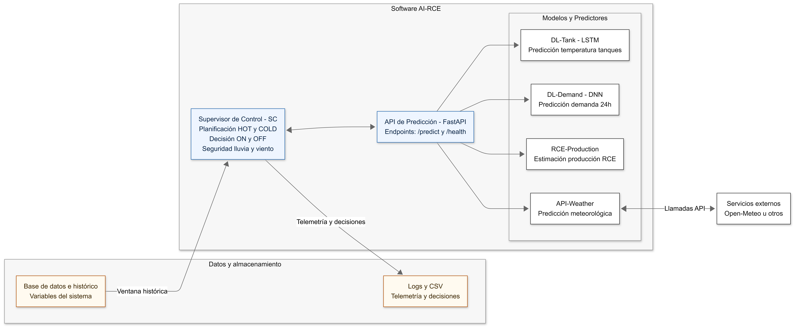

# AI-RCE — Control predictivo para sistemas híbridos basados en Radiative Collector and Emitter (RCE)

Repositorio de software para **predicción, supervisión y control inteligente** de un sistema híbrido basado en el concepto **RCE (Radiative Collector and Emitter)**, desarrollado en el marco del proyecto estatal **BOOST-RCE (TED2021-131446B-I00)**.

---

## Contexto del proyecto BOOST-RCE

El proyecto **BOOST-RCE** ha permitido optimizar el rendimiento del concepto innovador **RCE (Radiative Collector and Emitter)**, un sistema capaz de generar **calor y frío durante las 24 horas del día** con **emisiones de CO₂ nulas**. El RCE combina **captación solar térmica diurna** y **enfriamiento radiativo nocturno** para producir energía térmica por encima o por debajo de la temperatura ambiente, respectivamente.

Sus principales ventajas competitivas incluyen la **doble generación de energía renovable**, la **modularidad**, la **escalabilidad** y la **capacidad de integración con sistemas convencionales de climatización**, contribuyendo a incrementar la eficiencia energética y a reducir tanto el consumo como las emisiones asociadas.

Con el fin de maximizar la producción de frío nocturno, el sistema incorpora una **cubierta de polietileno de baja densidad (30 μm)** con elevada transmitancia en la **ventana atmosférica infrarroja (7–14 μm)**, donde la atmósfera presenta alta transparencia. Asimismo, se ha desarrollado un **sistema de control lógico inteligente** capaz de optimizar la operación diurna y nocturna. Este sistema compara las **predicciones de producción y demanda** y gestiona la activación de una **cubierta móvil de vidrio** en función de las condiciones ambientales y operativas, con el objetivo de **minimizar el consumo energético** e identificar los **intervalos de máxima eficiencia**.

Los ensayos realizados muestran que el RCE es capaz de alcanzar **temperaturas de agua entre 7,4 °C y 8,1 °C por debajo de la temperatura ambiente**. Paralelamente, los **modelos de predicción basados en técnicas de Deep Learning** han sido validados, proporcionando estimaciones precisas de producción y demanda, lo que permite **optimizar la operación futura del sistema** e identificar escenarios de mayor rendimiento.

Los resultados del proyecto evidencian que el RCE posee un **alto potencial para reducir el consumo de combustibles fósiles y el uso de agua**, así como para mejorar la **seguridad del suministro energético**. Su carácter distribuido disminuye las pérdidas por transporte y contribuye a la estabilidad de precios. En conjunto, el sistema RCE constituye una **tecnología limpia** que mejora el confort térmico, fortalece la sostenibilidad y amplía las posibilidades tecnológicas en los sectores de **climatización y energías renovables**.

---

## Descripción del software

Este repositorio implementa un **sistema de control predictivo basado en Machine Learning** que permite:

- Predecir la **producción térmica (frío/calor)** del sistema RCE.
- Predecir la **demanda energética** del edificio.
- Incorporar **predicciones meteorológicas** relevantes.
- Tomar decisiones automáticas de operación mediante un **Supervisor de Control (SC)**.
- Integrarse con un **PLC Siemens** para la operación del prototipo experimental.

El software ha sido validado sobre un **sistema RCE real**, combinando modelos de Deep Learning con control lógico industrial.

---

## Arquitectura del sistema

```
Sensores / PLC / Base de datos
            ↓
   Supervisor de Control (SC)
            ↓
      API de Predicción
   (FastAPI + Modelos ML)
            ↓
          PLC
            ↓
       Sistema RCE
```




Ver diagrama detallado en [`docs/architecture.md`](docs/architecture.md)

---

## Bucle de control del Supervisor de Control (SC)

El Supervisor de Control (SC) opera mediante un **bucle periódico de decisión** (tick configurable),
en el que integra estado histórico, predicciones basadas en *Machine Learning* y lógica de control
para decidir la operación óptima del sistema RCE.


Para una descripción detallada del funcionamiento y de la lógica `get_decision`,
consulte el documento [`docs/architecture.md`](docs/architecture.md).

## Estructura del repositorio

```
ai_rce/
├── api/                # API de predicción (FastAPI)
├── sc/                 # Supervisor de Control
├── docs/               # Documentación técnica y referencias
├── tests/              # Tests unitarios
├── watchdog_sc.py      # Watchdog del sistema
└── README.md
```

---

## Requisitos

- Python ≥ 3.10  
- TensorFlow / Keras  
- FastAPI  
- snap7 (integración con PLC Siemens)  
- Acceso a PLC real o entorno de simulación  

Dependencias:
- `api/requirements.txt`
- `sc/requirements.txt`

---

## Instalación

### API de predicción
```bash
cd api
python -m venv .venv
source .venv/bin/activate
pip install -r requirements.txt
```

### Supervisor de Control
```bash
cd sc
python -m venv .venv
source .venv/bin/activate
pip install -r requirements.txt
```

---

## Ejecución

### Arranque de la API
```bash
python -m api.main
```

Health check:
```
GET http://localhost:8000/health
```

### Arranque del Supervisor de Control
```bash
export SC_ENV=test   # o prod
python -m sc.main
```

### Modo sombra

`plc.mode` en `sc/config.<env>.json` (por defecto `"shadow"`): el control lee WinCC, predice y decide cada 15 min,
pero no se conecta al PLC ni escribe en él; el estado del RCE es virtual (`sc/plc_shadow.py`). Cada ciclo queda en
`dades.csv` con `execution`, estado, modo y tapa (`sc/cycle_log.py`) y en `state/status.json` (`sc/state_io.py`).
`plc.mode = "real"` conecta con el PLC (IP, rack y slot de la configuración). Horarios de calor y parada para el modo
sombra en `plc.shadow.schedule`.

### Panel RCE (página de supervisión y control)

```bash
export SC_ENV=prod
python -m panel.main        # https://localhost:8050 (y desde la red del laboratorio)
```

El panel (`panel/`) arranca y vigila la API y el control (`panel/supervisor.py`; si uno se para, lo vuelve a
arrancar tras 60 s, y la espera se dobla con cada fallo seguido hasta 15 min), y muestra en el navegador:
semáforos, estado del RCE, última decisión, avisos con qué hacer, lecturas de WinCC, historial, mandos manuales en
seco (`panel/dryrun.py`: la secuencia exacta de escrituras que haría el PLC, simulada), simulador rápido
(`panel/simulator.py`), diario de campaña (`state/diario.csv`) y ajustes. Se entra con nombre y PIN; los mandos exigen
«Tomar el mando» (una sola persona a la vez). Va por HTTPS con un certificado propio que el panel crea en `state/`
(`panel/tls.py`; el navegador avisa la primera vez, y el certificado se puede instalar desde `/certificado`;
`"https": false` en `state/panel_config.json` vuelve a HTTP). Especificación: `rce_review/panel_rce/ESPECIFICACION_panel_rce.md` del
repositorio de trabajo. Instalación en el PC del laboratorio: `deploy/install_shadow_lab.ps1` (ai_rce en sombra) y
después `deploy/install_panel.ps1` (tarea programada `RCE-Panel`, puerto 8050, acceso directo «Panel RCE»).
Para actualizar un PC que ya tiene el panel, después de `git pull --ff-only`: `deploy/update_lab.ps1` (un solo
comando como administrador; `-CheckOnly` para comprobar sin cambiar nada).

Fases 2 y 3 del panel: `sc/decision.py` (la decisión en tiempo real como función pura con motivos, que el panel
muestra y usa en el simulador), pestaña Control, simulador completo con el modelo y reproducción de un día
(`panel/simfull.py`), y **modo REAL** desde el panel: activación con doble confirmación (y comprobación de que el PLC
responde y de que ningún otro programa está conectado), mandos reales como trabajos con progreso y aborto
(`panel/plc_ops.py`; exigen el mando tomado y el control en pausa) y estado de salida configurable al volver a SOMBRA.
Probado contra `sc/plc_dummy.py` (PLC Snap7 simulado); en el laboratorio solo con autorización del equipo.

**Cuentas y perfiles.** El usuario es el correo de la UdL sin `@udl.cat` (se acepta también con el dominio y en
mayúsculas). Tres perfiles, según el nombre: `rce_admin` (superadministración: personas, contraseñas de otros, ajustes,
contraseña y activación del modo REAL, mandos reales), `rce_viewer` (cuenta compartida que solo mira y usa el
simulador) y el equipo (todos los demás: mando, mandos en seco, pausa, diario, arrancar y parar). La primera cuenta
que se crea es `rce_admin`, solo desde el propio PC del panel. El equipo se da de alta con
`python -m panel.import_users <fichero>` (un usuario o correo por línea): la contraseña inicial es el propio usuario y
el panel obliga a cambiarla en la primera entrada; lo mismo cuando `rce_admin` pone una contraseña a otra persona
(salvo `rce_viewer`). Cada persona cambia la suya en Ajustes → «Cambiar mi contraseña». La API comprueba el perfil en
cada petición.

**Agenda.** Pestaña Agenda: mantener un estado (frío, calor, parada o automático del PLC) entre dos horas, o lanzar
un mando a una hora; se puede repetir hasta 14 días seguidos. Mientras dura un estado, el control sigue decidiendo y
registrando, pero no aplica sus decisiones (pausa «agenda»); al terminar vuelve el control automático (por defecto),
parada o el estado de antes. En SOMBRA se aplica al estado simulado (el control atiende las órdenes del panel cada 10 s,
sin esperar al siguiente ciclo). En REAL solo se ejecutan las entradas de `rce_admin`, con los mismos trabajos que los
mandos reales, y cada estado puede abrir y cerrar un ensayo «manual» en el diario; las demás quedan en espera. Se guarda
en `state/agenda.json`. Probado de extremo a extremo contra `sc/plc_dummy.py`.

**Auditoría.** Pestaña Auditoría: todas las acciones del panel (entradas, salidas e intentos fallidos, mando, mandos,
agenda, ajustes, cuentas, modo, diario, simulador) con usuario, PC, modo y resultado; filtros por usuario, tipo y
periodo, y descarga en CSV (`/api/audit`, `/api/audit.csv`). El registro es `state/acciones.csv`, que Filebeat envía a
Kibana.

**Contraseña del modo REAL.** Activar REAL exige, además del mando y de las dos confirmaciones («¿Estás seguro?» y
escribir `REAL`), la contraseña del modo REAL. Recién instalado el panel no hay contraseña y la activación se rechaza
(403). La contraseña se define o cambia en Ajustes **solo desde el propio PC del laboratorio** (localhost), con el mando
y, si ya existía, con la actual; mínimo 8 caracteres; se guarda como hash PBKDF2 con sal en `state\panel_config.json`
(no versionado) y nunca se devuelve por la API. Cinco contraseñas incorrectas bloquean la activación 10 minutos y quedan
en el registro de acciones. Así el panel se usa desde la red (ver, diario, ensayos, mandos en seco, simuladores) y el
PLC solo lo toca quien conoce la contraseña.

### Cambios respecto al control original (campaña 2025)

| Qué | Antes (hasta 2026-10-21) | Ahora | Dónde |
|---|---|---|---|
| **Unidades del COP** | Consumo de la bomba en una franja = `P_bomba_watts × time_step_hours` = 10 W × 0,25 h = **2,5 Wh**, y COP = producción prevista **en J** / 2,5 Wh. Un COP en J/Wh, unas 3600 veces mayor que el real: con 500 kJ de producción salía 200 000, y el umbral `COP ≥ 1` no filtraba nada | Consumo de la bomba en **J** (2,5 Wh × 3600 = 9000 J) y COP adimensional: 500 kJ → 55,6; 5 kJ → 0,56 < 1 → no arranca. Configurable: `pump.cop_pump_energy_units = "J"` (por defecto) o `"Wh"` (comportamiento antiguo, para reproducir la campaña) | `sc/decision.py`, `sc/config.py` |
| Decisión explicable | Lógica dentro de `get_decision()` | `sc/decision.py::decide()` devuelve la misma decisión con motivos; comportamiento congelado por tests de regresión | `sc/decision.py`, `tests/test_decision.py` |
| **Clave de la franja** | Se busca la producción de la franja activa con `start.isoformat()` = `AAAA-MM-DDTHH:MM:SS`, pero la API escribe la previsión con `strftime("%Y-%m-%d %H:%M")` = `AAAA-MM-DD HH:MM` (`api/utils/out/structure.py`). Nunca coinciden: producción de la franja 0, COP 0, la IA nunca dice «sí». Campaña 2025: 704 ciclos, 543 en franja, **0 «sí»** | Se busca con la clave de la previsión (`AAAA-MM-DD HH:MM`) y, si no está, con la ISO. `control.frame_key_format = "forecast"` (por defecto) o `"iso"` (antiguo) | `sc/decision.py` |
| **Qué hace «sí»** | «Sí» (bomba ON) se traducía en el PLC como **alternar** el modo (`state_decision_yes`: frío → calor, calor → frío). Como el control dice «sí» cada 15 min mientras la franja siga activa, en una franja de frío el RCE habría alternado frío ↔ calor cada ciclo (abrir y cerrar la tapa sin parar). Nunca se vio porque «sí» nunca ocurrió | «Sí» fija el modo de la franja activa (frío → `ColdMode1`, calor → `HeatMode1`); «no» mantiene; «parada» para; el estado Automático del PLC no se abandona. `control.next_state_policy = "frame_mode"` (por defecto) o `"toggle"` (antiguo) | `sc/decision.py::next_state`, `sc/main.py::run_cycle` |
| **Ajuste de la demanda restante** | Cuando la bomba funcionaba se restaba `P_bomba_watts × time_step_hours × aleatorio(0,8–1,2)` = **2,5 Wh** a una demanda en **J**: la demanda nunca se cubría y el plan nunca se cerraba | Se resta la producción prevista de la franja (J) × aleatorio(0,8–1,2), hasta que haya medida real. `control.demand_adjust = "frame_prod"` (por defecto) o `"pump_wh"` (antiguo) | `sc/decision.py` |
| **Infrarrojo que entra al modelo** (2026-10-22) | Se leía `E_FIR, neto, [W/m2]_RCEb` de `Pyrgeometer0.csv`. Solo hay un pirgeómetro, en la unidad A: las etiquetas de la unidad B no son una medida y en los ficheros del laboratorio valen **33 W/m² fijos**. El modelo recibía siempre el mismo infrarrojo, positivo, como si nunca hubiera cielo despejado | Se lee `E_FIR, neto, [W/m2]_RCEa` (de −120 a 3 W/m² en los mismos ficheros; negativo = pérdida neta hacia el cielo). `control.ir_unit = "RCEa"` (por defecto) o `"RCEb"` (antiguo). El simulador completo del panel usa la misma entrada | `sc/utils/read_data.py`, `sc/config.py`, `panel/simfull.py` |

Los valores antiguos están juntos en `sc/config.*.json` → `control._antiguo` para reproducir la campaña 2025 copiándolos
a `control` y `pump.cop_pump_energy_units` (incluido `control.ir_unit`). Los tests de regresión (`tests/test_decision.py`) congelan ambos comportamientos.

Variables de entorno útiles: `SC_CONFIG` (ruta a un JSON de configuración distinto de `sc/config.<env>.json`),
`PANEL_WORK_DIR` (carpeta para `state/`, registros y `sc.log` fuera del repositorio, para pruebas),
`SC_SMTP_PASSWORD` / `GMAIL_APP_PASSWORD` o `sc/secrets.local.json` (contraseñas; `sc/credentials.py`).

---

## Configuración

La configuración se gestiona mediante ficheros `config.{env}.json` en `sc/`.

⚠️ **Antes de publicar el repositorio**:
- Eliminar credenciales sensibles.
- Usar variables de entorno o ficheros plantilla (`config.template.json`).

---

## Reproducibilidad y limitaciones

- Parte de los datos de demanda pueden ser simulados (TRNSYS).
- La validación completa depende de condiciones meteorológicas reales.
- El sistema está diseñado para **investigación y prototipos pre-industriales**.

---

## Referencias

- Proyecto **BOOST-RCE (TED2021-131446B-I00)** — Ministerio de Ciencia e Innovación, España  
- Vall et al., *Combined Radiative Cooling and Solar Thermal*, **Radiative Collector and Emitter (RCE)**, Energies, 2020  
- Trabajos Fin de Grado y Máster asociados al proyecto (Universitat de Lleida)
